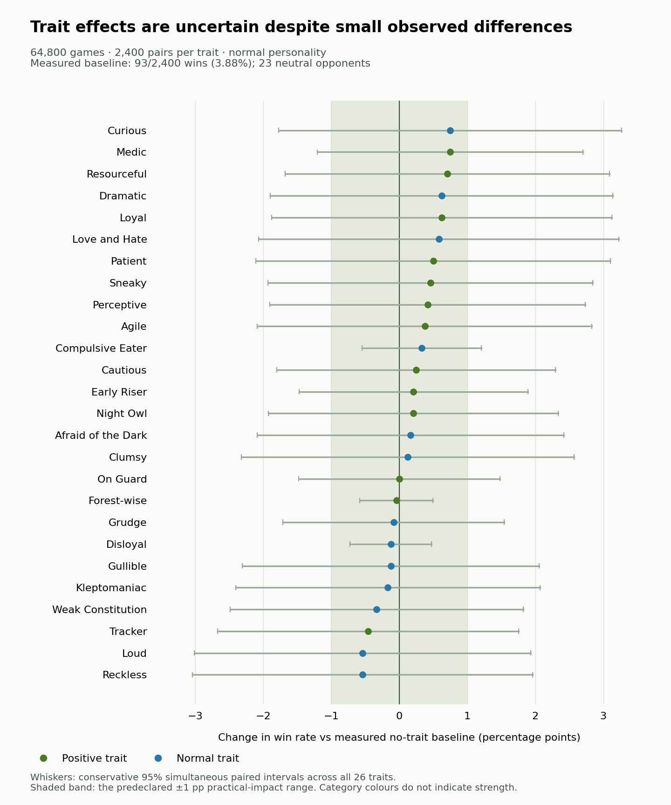

# Trait impact: running and interpreting experiments

The Demo statistics page now includes a separate Trait impact experiment and tier list. Positive traits have green outlines; normal (non-positive) traits have blue outlines. Category outlines do not imply measured strength.

## Using the interface

Open **Demo statistics**, then **Trait impact**. Use **Load included audit** to view the shipped audit, or choose traits, a seed and a pair count to run your own study. Danger, tone and personality come from the current game setup and are frozen in the experiment. Lore is disabled. A quick study uses 240 pairs; the main preset uses 2,400. A pair means one no-trait baseline and one treatment for every selected trait: all 26 traits at 2,400 pairs generate 64,800 games.

Cards show win rate, change from the measured baseline in percentage points, category and sample count. Open a card for wins/entrants, confidence intervals and description. The table provides the same results in a conventional format. Category filtering changes only the display, never the statistical adjustment.

Stop keeps saved complete seed blocks. Continue resumes with the recorded settings and seed indices. Reload can lose the currently computing block and up to the worker's progress update interval, but never counts a partial block. Reset clears only the trait experiment; export first to preserve it. JSON import accepts either an exported report or a validated experiment checkpoint. Existing general-demo statistics and archived seasons remain separate.

## Command-line runs

```powershell
# Main study: 2,400 independent seeds, all traits, eight CPU workers
node scripts/trait-runs.mjs --pairs 2400 --seed trait-main-v1 --workers 8 --output examples/trait-audit/main.json

# Resume the exact saved study after interruption
node scripts/trait-runs.mjs --resume --workers 8 --output examples/trait-audit/main.json

# Personality Off control, using fresh seeds
node scripts/trait-runs.mjs --pairs 24 --personality off --seed trait-off-v1 --workers 4 --output examples/trait-audit/control.json

# Focused confirmation: choose traits and use an independent seed namespace
node scripts/trait-runs.mjs --pairs 2400 --traits agile,clumsy --seed trait-confirm-v1 --workers 8 --output examples/trait-audit/confirmation.json
```

The CLI supports up to 100,000 pairs and 1–8 workers. Use `--danger`, `--tone` and `--personality` to declare separate scenario studies. Use a fresh output path for a new study. Resume reads the saved target and settings; it does not reinterpret command-line options as changes to that study. Concurrent workers compute independent seed blocks; the coordinator only commits consecutive complete blocks. Checkpoints are written via a temporary file and replacement. Ctrl+C requests a stop after active blocks finish; resume remains safe after a forced interruption as well.

## What the results measure

Every seed chooses a focal seat independently and uniformly from a fixed 24-player neutral cast. Baseline and treatments use the same seed, seat, IDs and settings. Each treatment adds exactly one trait to the focal tribute. Outcomes come from the engine winner ID. Baseline games are reused across traits; contestants in a shared game are never treated as independent samples.

The primary estimate is `100 × (treatment-only wins − baseline-only wins) / completed seeds`. Theoretical neutral win rate is 4.17%, but the measured control is the denominator for the comparison. Relative percentage changes are separate from percentage-point differences. No baseline wins means relative change is unavailable.

The uncertainty method bounds the two paired discordant probabilities with exact Clopper–Pearson binomial intervals and subtracts them. Splitting the error budget across the two cells gives at least nominal coverage by the union bound, without assuming the cells are independent. Splitting it again across all selected traits provides conservative 95% simultaneous effect intervals. The underlying exact binomial inversion follows [NIST's construction](https://itl.nist.gov/div898/software/dataplot/refman2/auxillar/exacbici.htm); implementation tests compare it with independent SciPy beta-quantile calculations, including sparse and large samples.

Tier placement uses the entire simultaneous interval. S requires an advantage above +2 pp; A above +1 pp; F a disadvantage below -1 pp. C requires the interval wholly within -1 to +1 pp. B/D indicate smaller established directional effects outside C. Everything else is Uncertain. The 1 pp practical threshold is a declared product choice, about 24% of the theoretical neutral win rate. It is not a property inferred from the experiment.

Partial studies are provisional. Final intervals are intended for the planned target, not repeated early stopping when a favourite trait appears significant. Neutral-opponent results do not establish combination strength, starting-alliance effects, or performance in a different danger/personality setup.

Before inspecting final main-study rankings, the confirmation rule is fixed: use a fresh seed namespace to retest the highest and lowest point estimates, plus every trait classified S, A or F in the main study. Run 2,400 pairs for each selected trait and apply the simultaneous adjustment across that selected set. Report this independent result separately; do not pool it into the main ranking or treat selection from the main study as confirmation by itself. The main study produced ties at both extremes; all tied traits are included, rather than choosing one arbitrarily.

## Simulation fidelity and checks

The analytics outcome path shares the ordinary simulation, event narrator, combat selection and mechanical random streams. It validates the fixed input once and each varying cast/seed, then omits run hashing, awards/recap assembly and final replay validation. It retains event narration because wording-use history influences later combat selection. The experiment adapter skips interviews, which use an independent stream and never feed encounter selection. The main audit began with interviews retained and resumed from a complete checkpoint after the interview-isolation and all-trait winner-equivalence checks passed; this optimization changes no mechanical outcome. It returns only a winner ID; it cannot produce an exportable replay.

The full-game, outcome-path and no-interview pilots use the same 24 seeds and all 26 traits. Their complete experiment reports match exactly. Separate tests compare ordinary and outcome-path winner IDs across all 26 traits/settings. Existing interview-isolation tests also compare complete gameplay events and placements with interviews enabled/disabled. Serial and two-worker smoke studies produce identical reports.

## Results

The main study completed **64,800 games**: 2,400 shared-seed comparisons for each of the 26 traits. Settings were normal danger, mixed tone and normal personality, with lore off. The measured baseline won **93/2,400 games (3.88%)**.

No trait established a meaningful advantage or disadvantage beyond the declared 1 pp threshold using simultaneous intervals. Forest-wise and Disloyal were supported as having effects inside -1 to +1 pp in this scenario. The other 24 traits remain unresolved; a small point estimate with a wide interval does not establish that its true effect is small.

The largest observed estimate was +0.75 pp (Curious and Medic, tied); the lowest was -0.54 pp (Loud and Reckless, tied). These are descriptive estimates, not established rankings between adjacent traits. All four tied extremes enter an independent 2,400-pair confirmation study under the same settings.

| Trait | Wins / pairs | Win rate | Effect vs baseline | 95% simultaneous effect interval | Tier |
| --- | --- | --- | --- | --- | --- |
| Curious | 111/2400 | 4.63% | 0.75 pp | -1.77 to 3.27 pp | Uncertain |
| Medic | 111/2400 | 4.63% | 0.75 pp | -1.20 to 2.70 pp | Uncertain |
| Resourceful | 110/2400 | 4.58% | 0.71 pp | -1.68 to 3.09 pp | Uncertain |
| Dramatic | 108/2400 | 4.50% | 0.63 pp | -1.89 to 3.14 pp | Uncertain |
| Loyal | 108/2400 | 4.50% | 0.63 pp | -1.88 to 3.12 pp | Uncertain |
| Love and Hate | 107/2400 | 4.46% | 0.58 pp | -2.07 to 3.23 pp | Uncertain |
| Patient | 105/2400 | 4.38% | 0.50 pp | -2.11 to 3.10 pp | Uncertain |
| Sneaky | 104/2400 | 4.33% | 0.46 pp | -1.93 to 2.84 pp | Uncertain |
| Perceptive | 103/2400 | 4.29% | 0.42 pp | -1.90 to 2.73 pp | Uncertain |
| Agile | 102/2400 | 4.25% | 0.38 pp | -2.09 to 2.83 pp | Uncertain |
| Compulsive Eater | 101/2400 | 4.21% | 0.33 pp | -0.55 to 1.21 pp | Uncertain |
| Cautious | 99/2400 | 4.13% | 0.25 pp | -1.80 to 2.30 pp | Uncertain |
| Early Riser | 98/2400 | 4.08% | 0.21 pp | -1.47 to 1.89 pp | Uncertain |
| Night Owl | 98/2400 | 4.08% | 0.21 pp | -1.92 to 2.34 pp | Uncertain |
| Afraid of the Dark | 97/2400 | 4.04% | 0.17 pp | -2.09 to 2.42 pp | Uncertain |
| Clumsy | 96/2400 | 4.00% | 0.13 pp | -2.32 to 2.57 pp | Uncertain |
| On Guard | 93/2400 | 3.88% | 0.00 pp | -1.48 to 1.48 pp | Uncertain |
| Forest-wise | 92/2400 | 3.83% | -0.04 pp | -0.58 to 0.50 pp | C |
| Grudge | 91/2400 | 3.79% | -0.08 pp | -1.71 to 1.54 pp | Uncertain |
| Disloyal | 90/2400 | 3.75% | -0.13 pp | -0.72 to 0.48 pp | C |
| Gullible | 90/2400 | 3.75% | -0.13 pp | -2.30 to 2.06 pp | Uncertain |
| Kleptomaniac | 89/2400 | 3.71% | -0.17 pp | -2.40 to 2.07 pp | Uncertain |
| Weak Constitution | 85/2400 | 3.54% | -0.33 pp | -2.49 to 1.82 pp | Uncertain |
| Tracker | 82/2400 | 3.42% | -0.46 pp | -2.67 to 1.75 pp | Uncertain |
| Loud | 80/2400 | 3.33% | -0.54 pp | -3.01 to 1.93 pp | Uncertain |
| Reckless | 80/2400 | 3.33% | -0.54 pp | -3.04 to 1.96 pp | Uncertain |



### Independent confirmation

The independent study completed **12,000 fresh-seed games**, with 2,400 pairs for each selected trait. Its neutral baseline won **110/2,400 games (4.58%)**. Intervals are adjusted across these four preselected traits, separately from the 26-trait main study.

| Trait | Main effect | Confirmation wins / pairs | Confirmation win rate | Confirmation effect | 95% simultaneous interval |
| --- | --- | --- | --- | --- | --- |
| Curious | 0.75 pp | 100/2400 | 4.17% | -0.42 pp | -2.60 to 1.77 pp |
| Medic | 0.75 pp | 96/2400 | 4.00% | -0.58 pp | -2.30 to 1.13 pp |
| Reckless | -0.54 pp | 88/2400 | 3.67% | -0.92 pp | -3.10 to 1.27 pp |
| Loud | -0.54 pp | 77/2400 | 3.21% | -1.38 pp | -3.46 to 0.72 pp |

All four confirmation intervals include zero and all four traits remain Uncertain. The positive main-study estimates for Curious and Medic reversed sign on fresh seeds, so their apparent advantage did not replicate. Loud and Reckless again had negative point estimates, but neither established a directional or greater-than-1-pp disadvantage after the simultaneous adjustment.

**Answer to the balance question:** neither study establishes a trait effect exceeding the declared 1 pp practical threshold. The observed ordering is not reliable enough to call the leading traits stronger. This does not prove all traits have small effects: most intervals still allow materially larger advantages or disadvantages. Forest-wise and Disloyal have evidence for small practical effects in the main neutral-opponent scenario. Relationship-rich casts, trait combinations and stronger personality settings remain separate questions.

To inspect the confirmation in the interface, export/reset the current trait study and import `examples/trait-audit/confirmation.json`. The included audit button loads the full 26-trait main study. The two studies are not pooled.

### Controls

The 24-pair Personality Off control generated 648 games. Every treatment had the identical winner ID to its paired baseline; no focal-win discordances occurred. This checks the disabled-traits control rather than estimating an effect.

## Focused Loud follow-up

The follow-up ran 9,600 games on fresh seeds, with 2,400 paired comparisons in each of two 24-player casts. In one cast, the 23 opponents had no traits. In the other, each opponent independently drew one trait from the 25 traits other than Loud. The focal seat, opponents and game seed were shared within each pair. The focal tribute had no trait in the control game and Loud in the treatment game. Danger and personality were normal, tone was mixed, and lore was disabled.

| Opponents | Control wins | Loud wins | Change in win rate | Simultaneous 95% interval |
| --- | ---: | ---: | ---: | ---: |
| Neutral | 101/2,400 (4.21%) | 90/2,400 (3.75%) | −0.46 pp | −2.38 to +1.47 pp |
| Mixed traits | 94/2,400 (3.92%) | 59/2,400 (2.46%) | −1.46 pp | −3.22 to +0.31 pp |

| Opponents | Encounters per 100 living rounds | Combat encounters per 100 living rounds | Eliminated in opening | Eliminated by end of day 2 |
| --- | ---: | ---: | ---: | ---: |
| Neutral, control → Loud | 75.64 → 78.13 | 53.10 → 54.22 | 22.04% → 25.96% | 58.92% → 60.08% |
| Mixed traits, control → Loud | 74.42 → 78.34 | 51.35 → 53.04 | 22.75% → 26.38% | 57.67% → 59.83% |

An encounter is a committed event that binds the focal tribute and at least one other player. Combat uses the engine's combat classification. Living rounds include the round of elimination. Per-game encounter counts fell slightly, from 4.34 to 4.32 in the neutral cast and from 4.35 to 4.30 in the mixed cast. Loud tributes took part in encounters at a higher rate while alive and spent fewer rounds alive overall.

Across 5,000 paired bootstrap resamples, the marginal 95% intervals for the increase in encounters per 100 living rounds were +1.42 to +3.58 in the neutral cast and +2.86 to +4.94 in the mixed cast. The opening elimination increases were +3.92 pp (interval +2.75 to +5.04) and +3.63 pp (interval +2.46 to +4.75), respectively. These secondary comparisons describe the scenarios tested.

The mixed-cast win-rate estimate exceeded the 1 pp penalty threshold in magnitude. Neither scenario's simultaneous interval fell below −1 pp, so the weighting reduction was not tested. The mixed-cast result applies to opponents with one randomly assigned non-Loud trait each.

Run or resume with `node scripts/loud-study.mjs measure 2400 8`. The [raw report](../examples/trait-audit/loud-measure.json) includes every paired observation and elimination counts by phase and day. Both win-rate intervals were independently recomputed with SciPy from the paired counts.

## Larger mixed-cast Loud replication

The replication uses 16,000 fresh seed pairs in the same mixed-cast setup as the focused follow-up. The seed namespace is `trait-loud-mixed-confirm-v1`. The primary outcome is the paired difference in win rate, Loud minus no trait. The fixed decision rule uses a one-sided 95% normal confidence bound from the sample variance of the paired win differences. A weighting experiment requires the upper bound to fall below −1 percentage point. This analysis uses one scenario and one directional hypothesis. The summary also includes the conservative two-sided paired interval used in the earlier experiment.

Run or resume with `node scripts/loud-study.mjs mixed-confirm 16000 8`.

The 32,000-game replication recorded 657 wins without a trait (4.11%) and 507 wins with Loud (3.17%). The paired effect was −0.94 pp. The conservative two-sided 95% interval was −1.59 to −0.29 pp. The one-sided 95% upper bound was −0.60 pp, so the study supports a penalty in this setup but does not establish that it exceeds 1 pp. The weighting test was not triggered.

The encounter and opening elimination patterns repeated. With Loud, encounters increased from 75.06 to 78.22 per 100 living rounds, and opening eliminations increased from 22.50% to 25.56%. The [raw report](../examples/trait-audit/loud-mixed-confirm.json) includes all pairs and elimination counts by phase and day.

## Validation status

Typecheck/build and the 66 browser regression tests pass. The shipped-audit browser check also passes (67 browser checks in total across the regression run and artifact check). The 22 focused analytics/engine checks pass, including all-trait winner equivalence; five existing interview-isolation checks also pass. The latest full unit run recorded 397 passing and 14 failing tests (13 assertions and one timeout during concurrent audit work). Three selected assertion failures also reproduce with the pre-feature engine wrapper reconstructed in memory. Details and reproducibility checks are in `examples/trait-audit/verification.json`.
